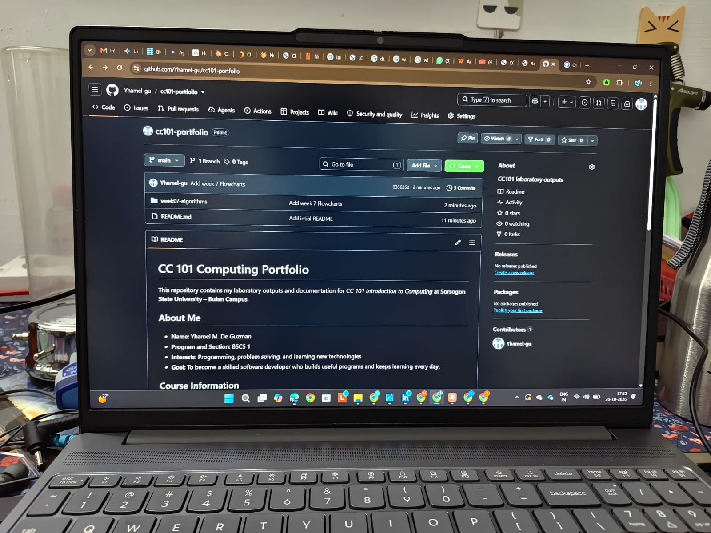

# CC 101 Introduction to Computing

This repository contains my laboratory outputs and documentation for *CC 101 Introduction to Computing* at **Sorsogon State University – Bulan Campus**.

## About Me

- **Name:** Yhamel M. De Guzman
- **Program and Section:** BSCS 1
- **Interests:** Programming, problem solving, and learning new technologies
- **Goal:** To become a skilled software developer who builds useful programs and keeps learning every day.

## Course Information

| Item | Details |
| --- | --- |
| Course | CC 101 Introduction to Computing |
| Instructor | John Mart D. Gabrentina |
| Academic Year | 2026–2027 |

## Portfolio Contents

| No. | Activity | Folder |
| --- | --- | --- |
| 1 | Explore Career Pathways | [activity-01-career-pathways](activity-01-career-pathways/) |
| 2 | Know Your Machine | [activity-02-know-your-machine](activity-02-know-your-machine/) |
| 3 | Exploring the Windows Command Line | [activity-03-command-line](activity-03-command-line/) |
| 4 | Base Conversion Laboratory | [activity-04-base-conversion](activity-04-base-conversion/) |
| 5 | Know Your Network Settings | [activity-05-network-settings](activity-05-network-settings/) |
| 6 | From Problem to README | [activity-06-from-problem-to-readme](activity-06-from-problem-to-readme/) |

## Sample Pseudocode: Decimal to Binary

```
START
  DISPLAY "Enter a whole number (0 or greater): "
  INPUT n
  SET binary = ""
  IF n = 0 THEN
    SET binary = "0"
  ELSE
    WHILE n > 0 DO
      SET remainder = n MOD 2
      SET n = n DIV 2
      SET binary = remainder + binary
    ENDWHILE
  ENDIF
  DISPLAY "Binary: ", binary
END
```

## My Workspace



---

*Last updated: 2026-10-23*
